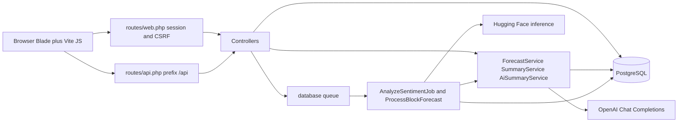
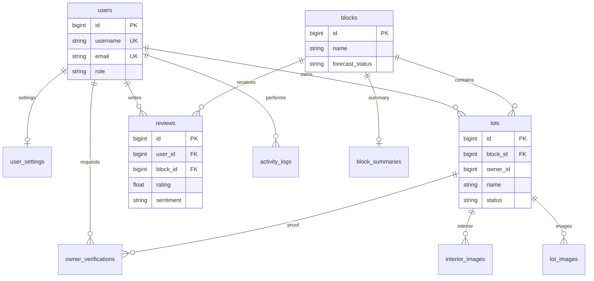

# LotMatch

LotMatch is a Laravel web application for exploring a residential subdivision, managing lots, and turning resident reviews into ratings, sentiment labels, and short AI narratives. Authenticated users browse a dashboard, a Three.js subdivision map, reviews, and a forecast page. Administrators also manage lots, users, ownership requests, analytics, and activity logs.

The application is a server-rendered Blade frontend with page-specific JavaScript. Laravel controllers and Eloquent models own the data. Background jobs call Hugging Face for review sentiment and OpenAI for lot and block text. There is no separate frontend application and no dedicated public API product; `routes/api.php` exposes JSON endpoints used by the same Blade pages.

## Contents

- [Project overview](#a-project-overview)
- [Technology stack](#b-technology-stack)
- [System architecture](#c-system-architecture)
- [Project directory structure](#d-project-directory-structure)
- [Frontend](#e-frontend-documentation)
- [Backend](#f-backend-documentation)
- [Database](#g-database-documentation)
- [Features and modules](#h-features-and-modules)
- [Routes](#i-api-and-route-documentation)
- [Authentication and security](#j-authentication-and-security)
- [Local installation](#k-installation-and-local-development)
- [Environment variables](#l-environment-variables)
- [Deployment](#m-deployment-guide)
- [Development workflow](#n-development-workflow)
- [Troubleshooting](#o-troubleshooting)
- [Limitations](#p-known-limitations-and-future-improvements)

---

## A. Project overview

### What it is

LotMatch models a subdivision as **blocks** and **lots**. A block is a neighborhood group. A lot is an individual property inside a block, with area, price, availability, orientation, sunlight, and flood risk. Residents and buyers leave one review per user per block. Those reviews feed charts, an exponential moving average (EMA) rating, and optional OpenAI summaries.

### Problems it addresses

- Browsing many lots in a subdivision from tables alone.
- Keeping lot availability, ownership, and images in one place.
- Summarizing resident comments and rating history for a block.
- Letting a buyer request recognition as an owner, and letting an administrator approve that request.

### Users and roles

Roles are stored on `users.role` as `buyer`, `owner`, or `admin` (`App\Models\User`).

| Role | How it is assigned | What the interface exposes |
|---|---|---|
| Buyer | Default for self-registration | Dashboard, 3D map, reviews, forecast, profile, and an ownership-request form |
| Owner | Administrator approval or an administrator edit | Same shared pages. The sidebar does not add owner-only links. Ownership is stored as `lots.owner_id` |
| Admin | Seeded account or user-management edit | Shared pages plus property management, analytics, user management, owner requests, and activity logs |

Sidebar visibility is not the same as route protection. Several admin screens are linked only for `admin`, but their routes sit in the general `auth` + `verified` group. See [Authentication and security](#j-authentication-and-security).

### Main functionality

- Username and password sign-in, self-service buyer registration, email-verification routes, and password-reset routes from Laravel UI.
- Dashboard counts for blocks, lots, average rating, and recent reviews, plus a small map preview.
- Interactive 3D subdivision view that loads `public/models/basic/housespawn.glb`, raycasts lots and blocks, and opens modals.
- Property CRUD for lots, including image upload, search, filters, and a printable table.
- Block reviews with a local profanity and link filter, one review per user per block, and queued sentiment plus forecast jobs.
- Forecast page and 3D modals that read stored block forecasts and can recompute an EMA from review ratings.
- Analytics page with block rating charts, a top-rated list, lot availability, and a rating distribution.
- Buyer ownership requests with a proof file, and administrator approve or reject actions.
- User administration, profile pages, a `show_owner_tags` setting, and model-level activity logs.

### Technologies

PHP 8.2+ and Laravel 12, Blade, Vite 6, Tailwind CSS 3 (prefix `tw-`), Bootstrap 5 and Sass, Alpine.js, Chart.js, and Three.js. PostgreSQL is the database the application SQL is written for. OpenAI and Hugging Face are optional HTTP integrations. Container deployment is a PHP Apache Dockerfile plus `entrypoint.sh`, with a `RENDER` flag for extra debug routes. Details are in the next section.

---

## B. Technology stack

### Frontend

| Technology | Where | Purpose |
|---|---|---|
| Blade | `resources/views` | Server-rendered pages, layouts, modals, and partials |
| Tailwind CSS 3.4 | `tailwind.config.js`, `resources/css/app.css` | Utility styling. Every utility is prefixed `tw-` so it can sit next to Bootstrap |
| Bootstrap 5 and Sass | `resources/sass/app.scss`, `resources/js/bootstrap.js` | Base stylesheet pulled in by the main layout through Vite |
| Alpine.js 3 | `resources/js/app.js` | Sidebar scroll state, account menu, and small page behaviors |
| Vite 6 and `laravel-vite-plugin` | `vite.config.js` | Dev server and production bundles under `public/build` |
| Axios | `resources/js/bootstrap.js` | HTTP client with `X-Requested-With`. Most feature code uses `fetch` instead |
| Chart.js 4 and `chartjs-adapter-date-fns` | Dashboard, analytics, forecast, and 3D modals | Rating and sentiment charts |
| Three.js 0.172 | `resources/js/three.js` and `resources/js/three-partials` | Subdivision scene, GLTF loading, orbit controls, outline and FXAA passes |
| GSAP | `resources/js/three.js` | Animation helper imported by the 3D entry |
| Font Awesome | npm package in `app.js`, plus a CDN stylesheet on the sign-in page | Icons |
| DOMPurify and Marked | `package.json` dependencies | Available to render Markdown forecast text. Confirm the importing module before relying on them in a new page |
| dat.GUI and stats.js | `package.json`; stats is imported in `three.js` | Debug helpers around the 3D scene |

### Backend

| Technology | Purpose |
|---|---|
| PHP `^8.2` (`composer.json`) | Runtime. The Dockerfile uses the `php:8.5-apache` image |
| Laravel 12 | HTTP kernel, Eloquent, queues, mail, and Blade |
| Laravel UI 4 | `Auth::routes(['verify' => true])` for login, registration, password reset, and verification scaffolding |
| Laravel Sanctum 4 | Installed. `User` uses `HasApiTokens`, and `personal_access_tokens` is migrated. No controller in this repository issues API tokens |
| Laravel Tinker | Included for the `php artisan tinker` REPL |
| Pest 3 | Test runner. The shipped tests are scaffolds |

### Database

`config/database.php` defaults `DB_CONNECTION` to `sqlite`. The queries and one migration are written for **PostgreSQL**:

- `PropertyController` uses `ILIKE`, `SPLIT_PART`, and `setval(pg_get_serial_sequence(...))`.
- `AnalyticsController` uses `REGEXP_REPLACE(..., 'g')`.
- `ForecastController` uses `EXTRACT(YEAR/MONTH FROM created_at)`.
- `2026_10_29_064619_make_price_nullable_in_lots_table.php` runs `ALTER TABLE lots ALTER COLUMN price DROP NOT NULL`, which is PostgreSQL syntax.

The Dockerfile installs both `pdo_mysql` and `pdo_pgsql`. Use PostgreSQL for a working local database. MySQL and SQLite are not supported by the current property, analytics, and price migrations.

### Authentication and authorization

Session guard `web` with the Eloquent `User` model (`config/auth.php`). Email verification is declared through `MustVerifyEmail` and the `verified` middleware. Role checks use `App\Http\Middleware\CheckRole`, aliased as `role` in `bootstrap/app.php`. Passwords use Laravel's `hashed` cast. Registration also calls `Hash::make` before `User::create`, which hashes a second time. See [limitations](#p-known-limitations-and-future-improvements).

### Data visualization

Chart.js draws dashboard rating distribution, analytics block ratings, sentiment trends, and forecast series. The analytics page embeds chart data in `data-*` attributes and reads them from `resources/js/pages/analytics/block-ratings-chart.js`. Forecast charts request `/forecast/block/{blockId}` and `/forecast/sentiment-trend/{blockId}`.

### 3D rendering

`resources/js/app.js` dynamically imports `resources/js/three.js` only when the path is `/3dmap`. That module builds a Three.js scene, loads `/models/basic/housespawn.glb` with `GLTFLoader`, and uses `EffectComposer`, `OutlinePass`, and `FXAAShader`. Lot status colors come from `GET /api/lots/statuses`. Lot and block clicks call `GET /block/{id}` and `GET /block/{blockId}/lot/{lotNumber}`.

The tracked `public/` directory in this repository does not contain `models/` or `images/`. The views expect `public/images/logoLM.png` and the loader expects `public/models/basic/housespawn.glb`. Add those files locally; they are not generated by Vite.

### Build and development tools

| Tool | Role |
|---|---|
| Composer | PHP dependencies. `composer dev` runs `php artisan serve`, `php artisan queue:listen --tries=1`, and `npm run dev` together |
| npm | Frontend dependencies. Scripts are `dev` (`vite`) and `build` (`vite build`) |
| PostCSS and Autoprefixer | Tailwind processing (`postcss.config.js`) |
| Laravel Pint | Dev dependency for PHP formatting. No project Pint config was found |
| Laravel Sail | Dev dependency. No `docker-compose.yml` or Sail runtime file is in the repository |
| Laravel Pail | Dev dependency for tailing logs |
| EditorConfig | `.editorconfig` |
| Pest | `php artisan test` or `./vendor/bin/pest` |

`slotm.sh` is a local helper that `cd`s to `~/lot-match-new` and opens GNOME terminals. It does not match this repository path and is not part of the application runtime.

### External APIs

| Service | Code | Behavior when unconfigured |
|---|---|---|
| OpenAI Chat Completions, model `gpt-3.5-turbo` | `App\Services\AiSummaryService`, `App\Services\SummaryService`, `OpenAITestController` | Lot summary returns “AI summarization is disabled.” Block summary returns “AI summary disabled temporarily.” or “unavailable” text. Controlled by `OPENAI_API_KEY` and `AI_SUMMARY_ENABLED` |
| Hugging Face `distilbert/distilbert-base-uncased-finetuned-sst-2-english` | `App\Jobs\AnalyzeSentimentJob` | If `SENTIMENT_ENABLED` is false, the review is saved as `neutral`. If the request fails, the error is logged and sentiment may stay empty |
| Hugging Face `unitary/toxic-bert` | `ReviewController::checkToxicity` | Implemented, not called from `store` or `update` |
| Hugging Face `cardiffnlp/twitter-roberta-base-sentiment` | `ReviewController::analyzeSentimentViaHuggingFace` | Used only by `POST /api/test-sentiment` |
| Mail | `config/mail.php` default mailer `log` | Verification and password-reset mail are written to the log unless `MAIL_*` is set |
| ui-avatars.com | `layouts/sidebar.blade.php` | Avatar image URL from the user's name. `users` has no `avatar` column; the Blade `Auth::user()->avatar` fallback only works if the attribute exists at runtime |

`lotmatch-sentiment/sentiment.js` is a standalone browser script for a different Hugging Face model. It is not imported by Vite. It references `API_TOKEN` while defining `API_KEY`, so it would throw if executed as written.

### Deployment and hosting

The repository deploys with `Dockerfile` and `entrypoint.sh`. There is no `render.yaml`, no `docker-compose.yml`, and no Forge or Vapor config. `config/app.php` reads `RENDER`. When that flag is true, `routes/web.php` registers `/check-db`, `/debug-verification-link`, `/debug/blocks`, and `/debug/users`.

---

## C. System architecture

LotMatch is one Laravel process that renders HTML and JSON. The browser loads Vite bundles, then calls same-origin routes. Long work is queued on the database `jobs` table and processed by `php artisan queue:work`.



### Frontend architecture

`resources/views/layouts/app.blade.php` is the authenticated shell: CSRF meta tag, sidebar, notification partial, settings modal, and the Vite bundle. Sign-in and sign-up are standalone documents and do not extend that shell. `resources/views/layouts/auth.blade.php` exists for a centered auth frame; the custom sign-in and sign-up pages do not extend it.

JavaScript is split by page and registered in `vite.config.js`. `resources/js/app.js` always loads Alpine, Font Awesome CSS, property helpers, and the 3D entry when the path is `/3dmap`.

### Backend architecture

HTTP enters `public/index.php`, which boots `bootstrap/app.php`. That file registers `routes/web.php`, `routes/api.php`, `routes/console.php`, and the health URI `/up`. The only application middleware alias added there is `role`.

`app/Providers/AppServiceProvider.php` forces the `https` URL scheme when `APP_ENV=production`.

`app/Http/Kernel.php` and `app/Providers/RouteServiceProvider.php` are present and are **not** referenced by `public/index.php` or `bootstrap/providers.php`. Their middleware lists and route registration do not run unless you wire them yourself. In particular, `ForceHttpsNgrok` and the CSRF exceptions in `app/Http/Middleware/VerifyCsrfToken.php` are not active through the current bootstrap.

`app/Console/Kernel.php` schedules `lots:generate-ai-summaries` every five hours. Laravel 12 does not boot that kernel from `bootstrap/app.php`. The command class can still be run manually. `routes/console.php` only registers the framework `inspire` command.

### Request flow

1. Apache or `php artisan serve` sends the request to `public/index.php`.
2. Web routes pass through Laravel's default web stack: cookies, session, CSRF, and bindings.
3. Routes in the `auth` and `verified` group require a session user with `email_verified_at` set.
4. Controllers validate input, read or write Eloquent models, and return a Blade view or JSON.
5. Models that use `App\Traits\LogsActivity` (`User`, `Lot`, `Block`, `Review`, `OwnerVerification`) insert an `activity_logs` row when a user is logged in.

### Database interaction

Eloquent is the normal path. Several controllers also use the query builder for aggregates (`DashboardController`, `AnalyticsController`, `ForecastService`). PostgreSQL-specific SQL is concentrated in property listing, analytics ordering, and forecast month extraction.

### Authentication flow

1. `GET /signin` renders `resources/views/signin.blade.php`.
2. `POST /signin` calls `AuthController::signin`, validates `username` and `password`, and calls `Auth::attempt`. A non-password key in `attempt()` is a column lookup, so this form logs in by `username`.
3. Success redirects to `/dashboard`. Failure redirects back with an error.
4. `GET /signup` and `POST /signup` create a `buyer`, send a verification notification, log the user in, and redirect to the dashboard.
5. Logout is the Laravel UI `POST /logout` route named `logout`, implemented by `LoginController::logout`, which redirects to `/login`.

`Auth::routes(['verify' => true])` also registers `/login`, `/register`, `/password/*`, and `/email/verify/...` before the custom verification closure later in `routes/web.php`. The first matching route wins, so the Laravel UI verification controller handles `GET /email/verify/{id}/{hash}`. The custom closure under the same URI is registered later and is not the first match.

### Authorization

`CheckRole` compares `$request->user()->role` with the roles passed to the middleware and returns 403 otherwise. It is applied to:

- `role:buyer` on `owner-verification/request`
- `role:admin` on user management, owner-request review, and activity logs

`User::isAdmin`, `isOwner`, and `isBuyer` exist and are not the middleware implementation.

### External services

Review submission queues `AnalyzeSentimentJob` and chains `ProcessBlockForecast`. The forecast job recomputes the EMA, builds a sentiment-by-month array, asks OpenAI for a narrative and a longer Markdown report, and stores the result on `blocks`. Lot summaries are generated synchronously by `AiSummaryService` when `GET /lot/{lot}/summary` is called, and can be queued by `php artisan lots:generate-ai-summaries`.

### How the pieces fit

The 3D page is a client of the block and lot JSON endpoints. The forecast page is a client of the stored forecast JSON. Property management is a classic form workflow with one AJAX fragment for filtered table HTML. Sentiment and OpenAI work are the only background processing.

---

## D. Project directory structure

```text
lotmatch-git/
├── app/
│   ├── Console/Commands/GenerateAiSummaries.php
│   ├── Http/Controllers/          Web and JSON actions
│   ├── Http/Middleware/           Including CheckRole
│   ├── Http/Requests/RegisterRequest.php
│   ├── Jobs/                      Sentiment, forecast, lot summary
│   ├── Models/
│   ├── Providers/AppServiceProvider.php
│   ├── Services/                  EMA, OpenAI block text, OpenAI lot text
│   ├── Traits/LogsActivity.php
│   └── View/Components/           sidebar-icon, table-search
├── bootstrap/app.php              Active application bootstrap
├── config/                        app, auth, database, filesystems, mail, queue, services
├── database/
│   ├── migrations/
│   ├── seeders/
│   └── factories/UserFactory.php
├── public/                        Web root. Vite build output is public/build
├── resources/
│   ├── css/                       Tailwind entry and page CSS
│   ├── js/                        app.js, three.js, page modules
│   ├── sass/app.scss              Bootstrap Sass entry
│   └── views/                     Blade pages, layouts, partials
├── routes/web.php                 Active web routes
├── routes/api.php                 Active /api routes
├── routes/console.php
├── routes/backupforweb.php        Not loaded by bootstrap
├── storage/                       Logs, cache, public uploads
├── tests/                         Pest scaffolds
├── Dockerfile
├── entrypoint.sh
├── composer.json
├── package.json
├── vite.config.js
└── tailwind.config.js
```

| Path | Responsibility |
|---|---|
| `app/Http/Controllers` | Request handling. Admin controllers live in `Admin/` |
| `app/Models` | Eloquent models and relationships |
| `app/Services` | EMA math and OpenAI prompts |
| `app/Jobs` | Queue workers for sentiment, block forecast, and lot summaries |
| `app/Http/Middleware/CheckRole.php` | The role middleware that `bootstrap/app.php` actually aliases |
| `resources/views` | HTML. `layouts/app.blade.php` wraps authenticated pages |
| `resources/js` | Client behavior. 3D code is under `three-partials/` and `pages/3d-map/` |
| `resources/css` | Page and component styles compiled by Vite |
| `database/migrations` | Schema history. Read in filename order; later migrations drop earlier columns |
| `database/seeders` | Blocks, lots, users, reviews, stored AI text, and lot image rows |
| `config/services.php` | `OPENAI_API_KEY` and `HUGGINGFACE_API_KEY` |
| `public` | Front controller, `.htaccess`, and static files the 3D scene and sidebar expect |
| `storage/app/public` | Uploaded lot images and owner proof files, after `php artisan storage:link` |
| `lotmatch-sentiment/` | Unused standalone sentiment script |
| `vendor/`, `node_modules/`, `public/build/` | Generated. Do not edit |

---

## E. Frontend documentation

### Technologies and architecture

Authenticated pages extend `layouts/app.blade.php`. That layout includes:

- `partials/app-config.blade.php`, which sets `window.App.userId`
- `layouts/sidebar.blade.php`
- `components/notification.blade.php`
- `components/modals/settings.blade.php`
- Vite inputs for Sass, `app.js`, settings, and the shared CSS files

Tailwind's `prefix: 'tw-'` is required. Unprefixed utilities in Blade will not be generated as Tailwind classes. `corePlugins.collapse` is disabled. Content paths include Blade, JS, and Vue files; there are no Vue single-file components in the repository.

`resources/css/app.css` contains `@tailwind` layers and is the stylesheet used by sign-in and sign-up. Authenticated pages rely on `resources/sass/app.scss` plus the CSS files listed in the layout. `resources/css/signin.css` and `resources/css/signup.css` exist and are not entries in `vite.config.js`.

### Page organization

| View | Route | Responsibility |
|---|---|---|
| `signin.blade.php` | `GET /signin` | Username and password form. Posts to `signin.submit` |
| `signup.blade.php` | `GET /signup` | Buyer registration. Includes privacy and terms partials in modals |
| `dashboard.blade.php` | `GET /dashboard` | Counts, recent reviews, rating chart, map preview |
| `3dmap.blade.php` | `GET /3dmap` | Full-viewport Three.js container, side panel, and modals |
| `reviews/index.blade.php` | `GET /reviews` | Review list and filters |
| `forecast/index.blade.php` | `GET /forecast` | Block picker and forecast charts |
| `properties/index.blade.php` | `GET /properties` | Lot table, filters, create and edit modals, print view |
| `properties/property-results.blade.php` | AJAX fragment from `PropertyController@index` | Table body returned as HTML |
| `analytics/analytics.blade.php` | `GET /analytics/block-ratings` | Charts and summary partials |
| `usermanagement/index.blade.php` | `GET /usermanagement/users` | User table and role modal |
| `owner-verification/create.blade.php` | `GET /owner-verification/request` | Buyer proof upload |
| `owner-verification/index.blade.php` | `GET /owner-verification/requests` | Admin queue |
| `activity_logs/index.blade.php` | `GET /activity-logs` | Filterable log table |
| `profile/index.blade.php`, `profile/edit.blade.php` | `/profile`, `/profile/edit` | Current user profile |
| `about.blade.php` | `GET /about` | In-app description of the system |
| `legal/privacy.blade.php`, `legal/terms.blade.php` | Included by the sign-up page | Not separate routes |
| `auth/*` | Laravel UI paths such as `/login` and `/email/verify` | Framework verification and password screens |
| `debug/verification-link.blade.php` | `GET /debug-verification-link` when `RENDER` is true | Prints a signed verification URL |

`MapController` returns `view('map')`. `PageController::contact` returns `view('contact')`. `BlockController::showForecast` returns `view('block-forecast')`. `ExploreController` returns `view('explore')`. Those Blade files are not in `resources/views`. `ContactController` and `ExploreController` have no routes. `usermanagement/create` and `usermanagement/edit` are returned by controller methods and were not present as Blade files in this tree; the index page drives create and edit through modals.

### Reusable partials and components

| Piece | Role |
|---|---|
| `components/sidebar-icon.blade.php` | One sidebar link with a tooltip. Class `App\View\Components\SidebarIcon` |
| `components/table-search.blade.php` | Search field used with `resources/js/components/tableSearch.js` |
| `partials/side-panel.blade.php` | 3D map side list |
| `partials/modals/lot-modal.blade.php` | Lot details, images, and AI summary |
| `partials/modals/block-modal.blade.php` | Block reviews and forecast entry |
| `partials/modals/full-report-modal.blade.php` | Stored long forecast report |
| `partials/modals/add-image-modal.blade.php` | Lot image upload |
| `partials/modals/lot-sold-modal.blade.php` | Sold-lot state |
| `partials/modals/quick-guide-modal.blade.php` | 3D quick guide |
| `partials/ai-status.blade.php` | “AI is working” popup used by the review form |
| `properties/property-modal.blade.php`, `edit-property-modal.blade.php` | Create and edit lot forms |
| `usermanagement/modals/user-form.blade.php` | Admin user form |
| `vendor/pagination/*` | Published Laravel pagination views |

### JavaScript organization

| Area | Files |
|---|---|
| Bootstrap and Axios | `resources/js/bootstrap.js`, imported by `app.js` |
| Always-on UI | `app.js`, `settings.js`, `components/lotSelector.js`, `components/userLotForm.js`, `components/tableSearch.js`, `features/password-toggle.js`, `pages/user-management/userModals.js` |
| Dashboard | `pages/dashboard/dashboard.js`, `pages/dashboard/dashboardMap.js` |
| Properties | `pages/properties/properties.js`, `property-filters.js`, `property-gallery.js` |
| Analytics | `pages/analytics/block-ratings-chart.js`, `pages/analytics/rating-distribution-chart.js` |
| Forecast page | `charts/forecast.js`, `pages/forecast/block-forecast.js`, `pages/forecast/forecast-skeletons.js` |
| Reviews page | `reviews.js` |
| 3D scene | `three.js` and `three-partials/*` |
| 3D helpers under `pages/3d-map/` | `three/init3dModel.js`, `three/house-hover.js`, `utils/lotDetailsRenderer.js`, `lotStatusRenderer.js`, `blockDetailsRenderer.js` |

`app.js` imports the property and user-management modules on every authenticated page, including the 3D map. Those modules no-op when their DOM nodes are absent.

### CSS

Vite entries are listed in `vite.config.js`. Page views add more entries with `@vite`. A new CSS file must be added to `vite.config.js` **and** to the Blade `@vite` directive. Tailwind classes used only in JavaScript template strings need to match `tailwind.config.js` `content` globs; some color utilities are also `safelist`ed.

### Vite asset management

`vite.config.js` inputs include `app.js`, dashboard, settings, reviews, sticky headers, forecast chart, properties, activity logs, sign-in autofill, analytics chart, signup, owner-verification lot select, and the CSS files named above. `three.js` is not its own input. It is loaded as a dynamic import from `app.js`, so it ships inside the `app.js` chunk graph.

Production builds write `public/build/manifest.json`. Blade `@vite` fails if that manifest is missing and `npm run dev` is not running.

### AJAX

Feature code uses `fetch` with `Accept: application/json` and, for mutating web routes, `X-CSRF-TOKEN` copied from the layout meta tag. Examples:

| Client | Endpoint |
|---|---|
| `three-partials/initClickHandler.js` | `GET /block/{id}`, `GET /block/{blockId}/lot/{lotNumber}` |
| `three-partials/loadHouses.js` | `GET /api/lots/statuses` |
| `three-partials/lot-summary.js` | `GET /lot/{lot}/summary` |
| `three-partials/reviews/reviewForm.js` | `POST /block-reviews`, `PUT /block-reviews/{id}` |
| `three-partials/reviews/forecast.js` | `GET /api/forecast/status/{block}` |
| `three-partials/detailsHandler.js`, `blockSummary.js` | `GET /api/forecast/db/{blockId}` |
| `pages/properties/property-filters.js` | `GET /properties` with `X-Requested-With` so the controller returns HTML JSON |
| `pages/properties/property-gallery.js` | `DELETE /property-images/{image}` |
| `modals/addImageModal.js` | `POST /lots/add-image`, `GET /lots/{id}/images`, `GET /lots/fallback-images` |
| `settings.js` | `GET` and `POST /user/settings` |
| `pages/forecast/block-forecast.js` | `GET /api/forecast/db/{blockId}` |

`PropertyController@index` treats `Request::ajax()` as the signal to return `{ html }` instead of the full page. `tableSearch.js` relies on that header.

### Forms and validation

Sign-up uses `RegisterRequest`: required names, unique email, and a password of at least 8 characters with upper, lower, and a digit, plus confirmation. Username is required and is **not** validated as unique, although the database unique index will reject a duplicate.

Property create and update rules live in `PropertyController`. Images must be jpeg, png, jpg, or gif and at most 5 MB. Owner proofs allow pdf, jpg, and png up to 5 MB. Review comments, when present, must be at least 15 characters, must not repeat one character six times, must not match a banned-word list or a URL, and must not duplicate that user's existing comment on the block.

Client checks are limited. The 3D review form requires a star rating before submit and displays the JSON `message` on 422.

### Modals, tables, and filters

Property and user tables paginate on the server. Property filters and search refetch the results partial. User search uses `GET /users/search`. Activity logs filter by role, table name, and user id, 25 rows per page. The 3D interface is modal-driven rather than a separate lot page.

### 3D visualization

`loadHouses.js` loads one GLB. Mesh names that start with `lot` are parsed as `lot_{lotId}_…_{blockId}`, with an optional `_r` suffix for mirroring. Meshes named `block_{id}` become selectable block volumes. Colored block markers are generated for block ids 1 through the color list length. Lot availability tints come from `/api/lots/statuses`.

Orbit controls, a sky, lights, an outline pass, and FXAA are set up in `three.js`. Hover and click behavior are in `initRaycasterOutlinePass.js` and `initClickHandler.js`.

### Charts

- Dashboard: `pages/dashboard/dashboard.js` reads rating counts rendered by `DashboardController`. The Blade file also loads Chart.js from a jsDelivr script tag.
- Analytics: `block-ratings-chart.js` plots average rating by block and can filter the series. Data is embedded by `analytics/analytics.blade.php`.
- Forecast: `charts/forecast.js` and `pages/forecast/block-forecast.js` draw historical ratings and monthly sentiment.
- 3D modals: `three-partials/forecastHandler.js` calls `GET /forecast/block/{blockId}`.

### Frontend to backend map

| Page | Primary controller |
|---|---|
| Sign in | `AuthController@signin` |
| Sign up | `Auth\RegisterController` |
| Dashboard | `DashboardController@dashboard` |
| 3D map | Closure returning `3dmap`, then `BlockController` and `LotController` JSON |
| Properties | `PropertyController` |
| Analytics | `AnalyticsController@dashboard` |
| Forecast | `ForecastController` |
| Reviews | `ReviewController` |
| Users | `Admin\UserManagementController` |
| Owner verification | `OwnerVerificationController` |
| Activity logs | `Admin\ActivityLogController` |
| Settings | `UserSettingsController` |
| About | `PageController@about` |

---

## F. Backend documentation

### Application structure

Controllers are thin in some places and large in others. Forecast math is in `ForecastService`. OpenAI prompts are in `SummaryService` and `AiSummaryService`. There is no repository layer and no policy class directory. Validation is inline on most controllers; registration is the exception (`RegisterRequest`).

### Controllers

| Controller | Responsibility | Main operations |
|---|---|---|
| `AuthController` | Custom sign-in | `signin` attempts username and password, redirects to `/dashboard` |
| `Auth\LoginController` | Laravel UI login screen and logout | `showLoginForm` returns `signin`; `logout` clears the session and redirects to `/login` |
| `Auth\RegisterController` | Buyer registration | `showRegistrationForm`, `register` |
| `Auth\ForgotPasswordController` | Password-reset email | Laravel UI trait |
| `Auth\ResetPasswordController` | Password-reset form | Laravel UI trait |
| `Auth\ConfirmPasswordController` | Password confirmation | Laravel UI trait |
| `Auth\VerificationController` | Verification notice | `showVerificationNotice` |
| `DashboardController` | Home metrics | `dashboard` |
| `BlockController` | Block JSON for the 3D UI | `getBlocks`, `show`, `getBlockWithReviewsAndLots`. `showForecast` points at a missing view |
| `LotController` | Lot JSON, images, AI summary | `getLots`, `show`, `addImage`, `getLotSummary`, `statuses` |
| `LotImageController` | Lot gallery JSON | `index`, `fallback` from `storage/app/public/fallback_images` |
| `PropertyController` | Lot administration | `index`, `store`, `update`, `destroy`, `destroyImage` |
| `ReviewController` | Reviews and comment checks | `index`, `blockReviews`, `store`, `update`, `destroy`, `edit` |
| `ForecastController` | Forecast page and JSON | `forecastPage`, `getForecastData`, `forecastBlockRating`, sentiment trends, `getForecastDataFromDb`, `status`, `getBlockSummary` |
| `AnalyticsController` | Analytics page | `dashboard` |
| `OwnerVerificationController` | Ownership workflow | `create`, `store`, `index`, `approve`, `reject` |
| `Admin\UserManagementController` | Users, roles, profile | `index`, `search`, `store`, `update`, `updateRole`, `destroy`, `profile`, `editProfile`, `updateProfile` |
| `Admin\ActivityLogController` | Audit table | `index` |
| `UserSettingsController` | Per-user UI flag | `get`, `update` for `show_owner_tags` |
| `SearchController` | Query-string redirect | `index` looks up a block or lot. It redirects to the route name `blocks.show`, which is not defined |
| `PageController` | Static pages | `about` is routed. `contact` is not, and the view is missing |
| `MapController` | Alternate map | `index` returns missing view `map`. Routed at `GET /map` |
| `ContactController` | Contact form | `showForm`, `submitForm`. No route. View `contact` is missing |
| `ExploreController` | Unused explorer | Filters `block_number`, a column that migrations drop. No route. View `explore` is missing |
| `ToolsController` | Manual sentiment backfill | `backfillSentiment` dispatches up to 50 jobs. Public `GET /tools/backfill-sentiment` |
| `OpenAITestController` | Connectivity check | `test` sends a one-sentence prompt. Public `GET /test-openai` |
| `DebugController` | Render verification helper | `verificationLink` |
| `HomeController` | Unused | `index` is not referenced from `routes/web.php` |

`routes/api.php` calls `ForecastController::getCombinedBlockInsight` and `LotController::generateSummary`. Those methods are not defined on the controllers.

### Models and relationships

| Model | Table | Relationships |
|---|---|---|
| `User` | `users` | `hasOne` `UserSetting`; `hasMany` `Lot` through `owner_id` |
| `UserSetting` | `user_settings` | `belongsTo` `User` |
| `Block` | `blocks` | `hasMany` `Lot`; `hasMany` `Review` |
| `Lot` | `lots` | `belongsTo` `Block`; `belongsTo` `User` as `owner`; `hasMany` `LotImage`. `reviews()` is `hasMany` `Review` on `block_id`, so a lot's “reviews” are the parent block's reviews |
| `Review` | `reviews` | `belongsTo` `User`; `belongsTo` `Block` |
| `LotImage` | `lot_images` | `belongsTo` `Lot` |
| `InteriorImage` | `interior_images` | `belongsTo` `Lot`. No controller reads or writes it |
| `BlockSummary` | `block_summaries` | No relationship methods. Written by `GenerateBlockSummaryJob`, which nothing dispatches |
| `OwnerVerification` | `owner_verifications` | `belongsTo` `User` and `Lot` |
| `ActivityLog` | `activity_logs` | No relationship methods |
| `Contact` | `contacts` | No relationships. Only `ContactController` writes it, and that controller is not routed |

`User`, `Lot`, `Block`, `Review`, and `OwnerVerification` include `LogsActivity`.

### Middleware

Active stack from `bootstrap/app.php` plus Laravel defaults:

| Alias or group | Behavior |
|---|---|
| `web` | Cookies, session, error sharing, CSRF, route bindings |
| `api` | Prefix `/api`, throttle, bindings |
| `auth` | Session authentication. `Authenticate` redirects guests to the login route |
| `verified` | `EnsureEmailIsVerified` |
| `role` | `CheckRole` |

`ForceHttpsNgrok` only treats hosts containing `ngrok-free.dev` as HTTPS, and only if `app/Http/Kernel.php` is the running kernel. It is not, with the current `public/index.php`.

### Services

`ForecastService::calculateForecast` loads ratings for a block in `created_at` then `id` order. The first rating is the seed. Each next rating uses `alpha * rating + (1 - alpha) * previous` with default `alpha` `0.3`. The result is rounded to two decimals. `calculateAndSaveForecast` writes `blocks.forecasted_rating`. `ProcessBlockForecast` calls the controller wrapper instead of `calculateAndSaveForecast`, then saves a wider set of columns itself.

`SummaryService::generateBlockSummaryViaGPT` sends the latest 10 comments, truncated to 150 words, to `gpt-3.5-turbo`. `generateFullForecastNarrative` and `generateDetailedForecastReport` ask for a livability narrative and a five-section Markdown report. Failures return bracketed placeholder strings that the UI can display.

`AiSummaryService::getLotSummary` returns the stored `lots.ai_summary` when present. Otherwise it calls OpenAI and stores the text. The prompt includes lot area, floor area, price, block id, status, orientation, sunlight, flood risk, and `modelUrl`.

### Validation

See the form section above. `UserManagementController@store` requires a role in `admin,owner,buyer` and a password of at least 6 characters, which is weaker than public registration. `updateRole` rejects lot ids already owned by someone else.

### Authentication

Documented in [section J](#j-authentication-and-security). The session driver defaults to `database` and the `sessions` table.

### Authorization

Role middleware covers user management, activity logs, and the two owner-verification route groups. Review updates check `user_id`. Review deletion allows the author or an admin. Lot image deletion and property routes do not check `role`.

### Database operations

Writes go through Eloquent `create`, `update`, and `delete`. Property creation can insert a missing block with an explicit id and then calls PostgreSQL `setval` so the `blocks.id` sequence stays ahead of that id. User role changes that assign lots run inside a transaction with `lockForUpdate`.

### File uploads and storage

| Upload | Disk | Stored path |
|---|---|---|
| Property images on create and update | `public` (`storage/app/public/lot_images`) | `lot_images.path` is saved as `storage/` plus the relative path |
| `POST /lots/add-image` | `public` | `lot_images.path` is the relative path **without** the `storage/` prefix |
| Owner proof | `public` (`owner_proofs/`) | `owner_verifications.proof_document` |

The public disk URL is `APP_URL/storage`. Run `php artisan storage:link` so `public/storage` points at `storage/app/public`. `PropertyController::destroyImage` deletes `$image->path` directly and does not strip a `storage/` prefix, unlike `update` and `destroy`.

The default disk is `local`, rooted at `storage/app/private`. Uploads that specify `'public'` do not use that disk.

### API endpoints

`routes/api.php` is mounted at `/api` by `bootstrap/app.php`. The routes do not use `auth`. See [section I](#i-api-and-route-documentation).

### Background work

| Job or command | Queue behavior |
|---|---|
| `AnalyzeSentimentJob` | Posted from review `store` and `update` when a comment is present, delayed 5 seconds. Calls Hugging Face DistilBERT SST-2. Maps `POSITIVE` and `NEGATIVE`; anything else becomes `neutral` |
| `ProcessBlockForecast` | Chained after the sentiment job, with its own 3 second delay. Sets `forecast_status` to `processing`, then `done`, and writes summary, report, EMA, sentiment JSON, and `forecast_updated_at` |
| `GenerateLotAiSummaryJob` | Dispatched by `lots:generate-ai-summaries` on the `ai-summaries` queue, 2 seconds apart per lot |
| `GenerateLotSummary` | Older OpenAI job. The file comments that it may be unused. It reads `config('services.openai.key')`, but `config/services.php` defines `api_key`, not `key` |
| `GenerateBlockSummaryJob` | Writes `block_summaries`. Imported by `ReviewController` and not dispatched |
| `lots:generate-ai-summaries` | Selects available lots whose `last_ai_summary_at` is null or older than `updated_at` |

`entrypoint.sh` starts `php artisan queue:work --sleep=3 --tries=3` in the background. Local `composer dev` uses `queue:listen --tries=1`. Nothing in the repository starts a scheduler process, and the five-hour schedule is on the unused console kernel.

Sentiment jobs and the forecast chain are dispatched with `DB::afterCommit`. With the default database queue they still need a worker. With `QUEUE_CONNECTION=sync` they run inside the request.

`AnalyzeSentimentJob` is delayed and then chained to a forecast job that was also given a delay. The forecast therefore runs only after sentiment handling finishes, plus queue delay behavior. The sentiment label may still be empty when the forecast job reads monthly counts, because the forecast is chained from a job that writes sentiment at the end of `handle`.

### Error handling

Controllers return validation errors, JSON 403 or 404 payloads, or session flash messages. OpenAI and Hugging Face failures are logged and converted into fallback strings or a skipped sentiment update. `bootstrap/app.php` does not register a custom exception renderer. `APP_DEBUG` controls Laravel's error page.

`public/info.php` is a PHP information script in the web root. Do not deploy it on a public host.

---

## G. Database documentation

### Engine

Configure PostgreSQL. The default connection name in `config/database.php` is `sqlite` only when `DB_CONNECTION` is unset. Session, cache, and queue defaults also use the database (`SESSION_DRIVER=database`, `CACHE_STORE=database`, `QUEUE_CONNECTION=database`).

### Entity relationship



`lots.owner_id` is an unsigned big integer without a foreign key. `block_summaries.block_id` is unique but the migration does not declare a foreign key. `interior_images.lot_id` and `lot_images.lot_id` cascade on lot delete.

### Application tables

Columns below are the result of applying migrations in timestamp order, including later drops. Types are the types declared in those migrations.

#### `users`

| Column | Notes |
|---|---|
| `id` | Primary key |
| `username` | Unique string. Added after the original `name` column |
| `first_name`, `last_name` | Nullable strings. `name` is dropped by `2025_12_11_034229_split_full_name_in_users_table.php` |
| `email` | Unique |
| `email_verified_at` | Nullable timestamp |
| `password` | String |
| `role` | Enum `buyer`, `owner`, `admin`, default `buyer` |
| `created_at`, `updated_at` | Timestamps |

`is_admin` is added and later removed. No migration adds `remember_token`, which Laravel's authenticatable model expects if “remember me” is used.

#### `blocks`

| Column | Notes |
|---|---|
| `id`, `name`, timestamps | Created first. `name` is the label seeded as `Block 1` through `Block 37` |
| `model_url` | Nullable string. Moved off `lots` by `2025_04_21_025242_move_model_url_to_blocks.php` |
| `ai_summary` | Nullable text. Narrative stored by `ProcessBlockForecast` |
| `full_forecast_report` | Nullable text. Longer Markdown report |
| `forecasted_rating` | Nullable float. EMA |
| `sentiment_data` | Nullable JSON |
| `forecast_updated_at` | Nullable timestamp |
| `forecast_status` | String, default `idle`. Job sets `processing` and `done` |

`description` is added and later dropped.

#### `lots`

| Column | Notes |
|---|---|
| `id`, timestamps | |
| `block_id` | Foreign key to `blocks`, `onDelete('cascade')`. Required |
| `owner_id` | Nullable unsigned big integer. No foreign key |
| `name` | String. Property forms store values such as `Lot 12`. Unique together with `block_id` (`lots_block_id_name_unique`) |
| `price` | `decimal(15, 2)`. A later migration makes it nullable using PostgreSQL syntax. Create validation still requires a price |
| `status` | Enum `available` or `sold`, default `available` |
| `lot_area`, `floor_area` | Nullable `decimal(8, 2)` |
| `orientation`, `sunlight`, `flood_risk` | Nullable strings |
| `modelUrl` | Nullable string. `2025_10_21_060033` adds `model_url`, and `2025_10_21_060558` renames it to `modelUrl`. The `down` method of the rename is empty |
| `ai_summary` | Nullable text |
| `last_ai_summary_at` | Nullable timestamp |

Dropped from `lots`: `description`, `size`, `view`, `block_number`, and the earlier `model_url` that was moved to blocks. `Lot` `$fillable` still lists `description`, `size`, and `view`.

#### `reviews`

| Column | Notes |
|---|---|
| `id`, timestamps | |
| `user_id` | Nullable foreign key to `users`, `onDelete('set null')` |
| `block_id` | Nullable foreign key to `blocks`, `onDelete('cascade')` |
| `rating` | Float |
| `comment` | Nullable text |
| `sentiment` | Nullable string. Values written by the job are `positive`, `negative`, and `neutral` |

`lot_id` and `user_name` are created and later dropped. Reviews are per block, not per lot. The application does not add a unique index on `(user_id, block_id)`; `store` enforces one review in code by updating the existing row.

#### `lot_images`

`id`, `lot_id` foreign key cascade, `path` string, timestamps.

#### `interior_images`

`id`, `lot_id` foreign key cascade, `image_path` string, timestamps. Unused by controllers.

#### `block_summaries`

`id`, `block_id` unsigned big integer unique, `summary` text, timestamps. No foreign key. Parallel to `blocks.ai_summary`, which is the column the forecast job updates.

#### `owner_verifications`

`id`, `user_id` foreign key cascade, `lot_id` nullable foreign key `onDelete('set null')`, `proof_document` string, `status` enum `pending`, `approved`, `rejected` default `pending`, timestamps.

#### `user_settings`

`id`, `user_id` unique foreign key cascade, `show_owner_tags` boolean default true, timestamps.

#### `activity_logs`

`id`, `user_id` foreign key cascade, `role` string, `action` string, `table_name` string, `record_id` nullable, `old_data` and `new_data` nullable JSON, `ip_address` nullable string, timestamps. The trait `json_encode`s the arrays before assigning them to JSON columns.

#### `contacts`

`id`, `name`, `email`, `message`, timestamps.

### Framework tables

| Table | Purpose |
|---|---|
| `sessions` | Database sessions. `user_id` nullable and indexed, `payload` long text, `last_activity` indexed |
| `password_resets` | `email` index, `token`, nullable `created_at`. This is the old Laravel table |
| `cache`, `cache_locks` | Database cache |
| `jobs` | Database queue |
| `failed_jobs` | Failed queue payloads |
| `personal_access_tokens` | Sanctum tokens. Nothing in `app/` creates them |

`config/auth.php` defaults the password broker table to `password_reset_tokens`. The migration creates `password_resets` and does not create `password_reset_tokens`. Password reset will not find the configured table unless `AUTH_PASSWORD_RESET_TOKEN_TABLE=password_resets` or a new migration is added. This README does not change that schema.

### Design notes

- Block and lot identity for the 3D scene is numeric. Seeded blocks use ids 1 through 37, and the GLB mesh names encode those ids.
- AI output is denormalized onto `blocks` and `lots` so the UI can render it without another provider call. `block_summaries` is a second store that the live review flow does not update.
- `owner_id` can point at a deleted user because there is no foreign key. Deleting a user does not cascade to lots. `activity_logs.user_id` does cascade, so deleting a user deletes that user's log rows.
- Several migrations branch on `information_schema` or use `change()` and PostgreSQL `ALTER COLUMN`. A partial migrate on the wrong driver will stop on those files.

---

## H. Features and modules

### Authentication and accounts

**Purpose.** Identify buyers, owners, and administrators.

**Functionality.** Username login, buyer registration, Laravel UI login and password reset, email verification, profile view and edit, logout.

**Frontend.** `signin.blade.php`, `signup.blade.php`, `resources/js/signup.js`, `resources/js/pages/sign-in/autofill.js`, `profile/index.blade.php`, `profile/edit.blade.php`.

**Backend.** `AuthController`, `Auth\RegisterController`, `Auth\LoginController`, Laravel UI controllers, `UserManagementController` profile methods.

**Models and tables.** `User`, `users`.

**Workflow.** Registration creates `role=buyer`, sends the verification notification, and logs the user in. Dashboard routes use `verified`, so an unverified user is sent to the verification notice. Seeded demo users set `email_verified_at`. Self-registration depends on mail. The password is hashed in the controller and again by the `hashed` cast.

**Status.** Implemented, with the double-hash and password-reset table mismatch described above.

### User and role management

**Purpose.** Let an administrator create users, change roles, assign lots to owners, and delete users.

**Frontend.** `usermanagement/index.blade.php`, `modals/user-form.blade.php`, `partials/user-table.blade.php`, `resources/js/pages/user-management/userModals.js`.

**Backend.** `Admin\UserManagementController`. Routes are behind `auth`, `verified`, and `role:admin`.

**Tables.** `users`, `lots.owner_id`.

**Workflow.** `update` and `updateRole` clear `owner_id` when the user is not an owner, then assign the submitted lot ids. Assigning a lot that another owner already holds returns a validation error. Promoting a user to owner or admin in `update` also sets `email_verified_at`.

`create` and `edit` return Blade views that are not in the tree. The index UI is the maintained screen.

### Property and lot management

**Purpose.** Maintain the lot inventory shown in the 3D scene and tables.

**Frontend.** `properties/index.blade.php` and the property partials, `properties.js`, `property-filters.js`, `property-gallery.js`.

**Backend.** `PropertyController`. Creating a lot prefixes the submitted number with `Lot `. If `block_id` does not exist, the controller inserts `Block {id}` and advances the PostgreSQL sequence.

**Tables.** `lots`, `blocks`, `lot_images`.

**Workflow.** Index supports search, status, and block filters, 10 rows per page. AJAX requests receive rendered HTML. Update can delete selected images and append new ones. Destroy deletes image files and the lot row. Block delete cascades to lots because of the foreign key.

**Status.** Implemented for PostgreSQL. Routes are authenticated, not admin-only.

### Block management

There is no block administration screen. Blocks are seeded, returned as JSON by `BlockController@getBlocks` and `@show`, and created implicitly when a property is stored with a new numeric block id. The 3D scene assumes block mesh names and seeded ids line up.

### Ownership verification

**Purpose.** A buyer submits a document for a lot. An administrator approves or rejects it.

**Frontend.** `owner-verification/create.blade.php`, `select-lot.js`, `owner-verification/index.blade.php`.

**Backend.** `OwnerVerificationController`.

**Tables.** `owner_verifications`, `users.role`, `lots.owner_id`.

**Workflow.** The buyer must be `role:buyer`. The proof file is required. `lot_id` may be null. Approval sets the request to `approved`, sets the user's role to `owner`, and, when a lot was chosen, sets `lots.owner_id`. Rejection only changes `status` to `rejected`. Approval does not check that the lot already has an owner. It does not revert the role if a later request is rejected.

### Reviews and sentiment

**Purpose.** Collect a 1–5 rating and an optional comment per user per block, then label the comment.

**Frontend.** `reviews/index.blade.php`, `reviews.js`, and the 3D block modal via `three-partials/reviews/reviewForm.js`.

**Backend.** `ReviewController`. Sentiment is `AnalyzeSentimentJob`, not the toxicity method and not `lotmatch-sentiment/`.

**Tables.** `reviews`.

**Workflow.** `store` updates the user's existing review for that block or inserts one. A non-empty comment queues sentiment analysis and a block forecast. Update is allowed only for the author. Delete is allowed for the author or an admin. `checkToxicity` is never called, so toxic-bert is not part of this workflow. The banned-word list is.

**Status.** Implemented when a queue worker is running and `HUGGINGFACE_API_KEY` is set. With `SENTIMENT_ENABLED=false`, comments are stored as `neutral` without a provider call.

### AI-generated summaries

Two different summaries exist.

| Target | Writer | Storage | Trigger |
|---|---|---|---|
| Lot blurb | `AiSummaryService` | `lots.ai_summary`, `lots.last_ai_summary_at` | `GET /lot/{lot}/summary`, or `lots:generate-ai-summaries` |
| Block narrative and long report | `SummaryService` inside `ProcessBlockForecast` | `blocks.ai_summary`, `blocks.full_forecast_report` | Review create or update with a comment |
| Block summary row | `GenerateBlockSummaryJob` | `block_summaries.summary` | Not dispatched |

`getBlockSummary` on `ForecastController` generates a narrative during the request and returns it. It does not persist that response. `getForecastData` generates text and then returns the **stored** block columns, ignoring the freshly generated strings. The 3D client reads stored data from `GET /api/forecast/db/{blockId}`.

If the API key is missing or `AI_SUMMARY_ENABLED` is false, the services return explicit disabled or unavailable sentences. They do not invent a forecast number; the EMA still runs from ratings.

Seeders `BlockAiSummarySeeder`, `ForecastRatingsSeeder`, and `FullForecastReportSeeder` can prefill block text so the UI has content before any OpenAI call.

### Forecasting and predictive analytics

**Purpose.** Turn ordered review ratings into one EMA number and show rating history and sentiment counts.

**Frontend.** `forecast/index.blade.php`, `charts/forecast.js`, `pages/forecast/block-forecast.js`, 3D `forecastHandler.js`.

**Backend.** `ForecastController`, `ForecastService`, `ProcessBlockForecast`.

**Tables.** `reviews` for inputs. `blocks.forecasted_rating`, `sentiment_data`, `forecast_status`, `forecast_updated_at` for stored output.

**Workflow.** `forecastBlockRating` returns the EMA plus the raw rating rows for the chart. `getBlockSentimentTrends` counts `positive`, `neutral`, and `negative` by month using PostgreSQL `EXTRACT`. `fetchSentimentTrends` folds other labels into `neutral` and only accumulates `positive` and `negative`. `getForecastDataFromDb` computes a satisfaction percentage as `((forecast - 1) / 4) * 100` when a forecast exists. `status` returns `forecast_status` for the 3D polling loop.

There is no separate `forecasts` table.

### Property analytics and charts

**Purpose.** Rank blocks by average rating and show sold versus available lots.

**Frontend.** `analytics/analytics.blade.php` and partials `summary-metrics`, `ratings-overview`, `top-rated`, `lot-availability`, `ratings-table`, `pie-chart`. Script: `block-ratings-chart.js`.

**Backend.** `AnalyticsController@dashboard`.

**Tables.** `blocks`, `reviews`, `lots`.

**Status.** Implemented. The block sort uses PostgreSQL `REGEXP_REPLACE`. The page is linked for admins and the route is any verified user.

### 3D subdivision visualization

**Purpose.** Walk the subdivision, select a lot or block, and open reviews, images, and forecasts.

**Frontend.** `3dmap.blade.php`, `resources/js/three.js`, `three-partials/`, `pages/3d-map/`.

**Backend.** Public `GET /blocks`, `GET /block/{id}`, `GET /lots/{blockId}`, `GET /block/{blockId}/lot/{lotNumber}`, plus authenticated review and image routes, plus `GET /api/lots/statuses`.

**Tables.** `blocks`, `lots`, `reviews`, `lot_images`.

**Workflow.** The GLB is the geometry. Database rows supply status, price, owner, and reviews. `BlockController@show` builds a public URL `asset('models/' . $block->model_url)` when `model_url` is set. The current loader does not fetch a per-block GLB; it always loads `/models/basic/housespawn.glb`.

**Status.** Implemented in code. The GLB file itself is not in the tracked `public/` tree documented here. Dashboard `dashboardMap.js` is a lighter preview on the dashboard, not a second copy of the full scene.

### Activity logs

**Purpose.** Record create, update, and delete for models using `LogsActivity`, when a session user exists.

**Frontend.** `activity_logs/index.blade.php`, `resources/js/activity_logs/activityLogs.js`.

**Backend.** The trait writes the row. `ActivityLogController@index` lists it. Seeders and jobs that run without a session user do not log.

**Table.** `activity_logs`.

**Status.** Implemented for authenticated model events. Guest review attempts never reach `store` because that route is behind `auth`. Queue jobs that later update `sentiment` or block forecast columns do log only if `Auth::user()` is still available in the worker, which it is not for a normal `queue:work` process. Those job updates are therefore not activity-logged.

### Dashboard and reporting

`DashboardController` passes total blocks, total lots, average rating, reviews created this calendar month, the five newest reviews, and a rating-to-count map. The printable property table is `properties/printable-table.blade.php` with `resources/css/print.css`. There is no PDF generator and no scheduled report mailer.

The in-app About page (`about.blade.php`) describes jobs and modules in marketing language. Where it disagrees with this README, the controllers and jobs are the source of truth. For example, the live review path chains `ProcessBlockForecast` rather than dispatching `GenerateBlockSummaryJob`.

---

## I. API and route documentation

Web routes use the `web` middleware group. API routes use the `api` group and the `/api` prefix. Unless noted, web routes send session cookies and require a CSRF token on unsafe methods.

`Auth::routes(['verify' => true])` also registers Laravel UI's `/login`, `/logout`, `/register`, `/password/reset`, `/password/email`, `/password/reset/{token}`, `/email/verify`, `/email/verify/{id}/{hash}`, and `/email/verification-notification`. Those names follow Laravel UI (`login`, `logout`, `register`, `password.request`, `password.email`, `password.reset`, `verification.notice`, `verification.verify`, `verification.send`).

### Public web routes

| Method | URI | Handler | Purpose | Auth |
|---|---|---|---|---|
| GET | `/` | Closure | Redirects to `dashboard` | No |
| GET | `/up` | Framework health | Health check from `bootstrap/app.php` | No |
| GET | `/signin` | `LoginController@showLoginForm` | Sign-in page | No |
| POST | `/signin` | `AuthController@signin` | Username login | No |
| GET | `/signup` | `RegisterController@showRegistrationForm` | Registration page | No |
| POST | `/signup` | `RegisterController@register` | Create buyer | No |
| GET | `/about` | `PageController@about` | About page | No |
| GET | `/blocks` | `BlockController@getBlocks` | All blocks as JSON | No |
| GET | `/lots/{blockId}` | `LotController@getLots` | Lots for a numeric block id | No |
| GET | `/block/{id}` | `BlockController@show` | Block with lots and reviews | No |
| GET | `/block/{blockId}/lot/{lotNumber}` | `LotController@show` | One lot named `Lot {lotNumber}` | No |
| GET | `/blocks/{blockId}/lots/{lotNumber}` | `LotController@show` | Duplicate lot lookup. Name `lots.show` is assigned twice; this definition wins | No |
| GET | `/search` | `SearchController@index` | Redirect search. Named `search` | No |
| GET | `/lot/{lot}/summary` | `LotController@getLotSummary` | OpenAI or stored lot summary | No |
| GET | `/test-openai` | `OpenAITestController@test` | OpenAI probe | No |
| GET | `/test-web` | Closure | Returns a plain string | No |
| GET | `/tools/backfill-sentiment` | `ToolsController@backfillSentiment` | Queues sentiment jobs | No |
| GET | `/users/search` | `UserManagementController@search` | User search JSON. No `auth` middleware on this route | No |

`GET /blocks/{blockId}/lots/{lotNumber}` is also registered earlier to `LotController@showLot`, which does not exist. The later registration to `show` is the one named `lots.show`.

### Authenticated web routes

Group middleware: `auth`, `verified`.

| Method | URI | Handler | Purpose | Extra auth |
|---|---|---|---|---|
| GET | `/dashboard` | `DashboardController@dashboard` | Dashboard | |
| GET | `/3dmap` | Closure `view('3dmap')` | 3D page | |
| GET | `/map` | `MapController@index` | Missing `map` view | |
| GET, POST | `/properties` | `PropertyController@index`, `@store` | List and create lots | |
| PUT or PATCH | `/properties/{property}` | `PropertyController@update` | Update lot | |
| DELETE | `/properties/{property}` | `PropertyController@destroy` | Delete lot | |
| GET | `/analytics/block-ratings` | `AnalyticsController@dashboard` | Analytics | |
| GET | `/forecast` | `ForecastController@forecastPage` | Forecast page | |
| GET | `/forecast/data/{blockId}` | `ForecastController@getForecastData` | Stored forecast JSON, after an unused generation call | |
| GET | `/forecast/block/{block_id}` | `ForecastController@forecastBlockRating` | EMA and rating series | |
| GET | `/forecast/sentiment-trend/{blockId}` | `ForecastController@getBlockSentimentTrends` | Monthly sentiment counts | |
| POST | `/block-reviews` | `ReviewController@store` | Create or update the caller's review | |
| PUT | `/block-reviews/{review}` | `ReviewController@update` | Author-only update | |
| DELETE | `/block-reviews/{review}` | `ReviewController@destroy` | Author or admin | |
| GET | `/reviews` | `ReviewController@index` | HTML or JSON | |
| GET | `/blocks/{blockId}/reviews` | `ReviewController@blockReviews` | JSON reviews | |
| GET | `/blocks/all/reviews` | `ReviewController@blockReviews` | JSON reviews, all blocks | |
| GET | `/block/{block}/with-reviews-lots` | `BlockController@getBlockWithReviewsAndLots` | Block JSON | |
| GET, POST | `/user/settings` | `UserSettingsController` | Read and save `show_owner_tags` | |
| GET | `/profile` | `UserManagementController@profile` | Profile | |
| GET, POST | `/profile/edit` | `editProfile`, `updateProfile` | Edit profile | |
| POST | `/lots/add-image` | `LotController@addImage` | Upload one image | |
| GET | `/lots/{lotId}/images` | `LotImageController@index` | Image paths | |
| GET | `/lots/fallback-images` | `LotImageController@fallback` | Files in `fallback_images` | |
| DELETE | `/property-images/{image}` | `PropertyController@destroyImage` | Delete one image | |
| GET, POST | `/owner-verification/request` | `OwnerVerificationController@create`, `@store` | Buyer request | `role:buyer` |
| GET | `/usermanagement/users` | `UserManagementController@index` | User admin | `role:admin` |
| GET | `/usermanagement/users/create` | `@create` | Missing view | `role:admin` |
| POST | `/usermanagement/users` | `@store` | Create user | `role:admin` |
| GET | `/usermanagement/users/{user}/edit` | `@edit` | Missing view | `role:admin` |
| PUT | `/usermanagement/users/{user}` | `@update` | Update user | `role:admin` |
| PATCH | `/usermanagement/users/{user}/role` | `@updateRole` | Role and lot assignment JSON | `role:admin` |
| DELETE | `/usermanagement/users/{user}` | `@destroy` | Delete user | `role:admin` |
| GET | `/owner-verification/requests` | `OwnerVerificationController@index` | Request queue | `role:admin` |
| POST | `/owner-verification/approve/{id}` | `@approve` | Approve | `role:admin` |
| POST | `/owner-verification/reject/{id}` | `@reject` | Reject | `role:admin` |
| GET | `/activity-logs` | `ActivityLogController@index` | Logs | `role:admin` |

Resource route names follow Laravel: `properties.index`, `properties.store`, `properties.update`, `properties.destroy`. Show, create, and edit are excluded.

### Email verification routes in `web.php`

These are registered in addition to Laravel UI:

| Method | URI | Name | Notes |
|---|---|---|---|
| GET | `/email/verified-success` | `verification.success` | Success view |
| GET | `/email/verify/{id}/{hash}` | `verification.verify` | Custom closure. Same URI as Laravel UI, registered later |
| GET | `/email.verify` | `verification.notice` | Notice. Middleware `auth`. The path uses a dot |
| POST | `/email/verification-notification` | `verification.send` | Resend. Middleware `auth` and `throttle:6,1` |

The custom verify closure marks the email verified without `URL::hasValidSignature` when `APP_ENV` is `production`. Because Laravel UI registers the same path first, that closure is not the first match. Do not treat the skipped signature check as the active verifier without confirming route order with `php artisan route:list`.

### API routes

No `auth` middleware is applied in `routes/api.php`.

| Method | URI | Handler | Purpose |
|---|---|---|---|
| GET | `/api/dummy-test` | Closure | Returns `{ "ok": "dummy route working" }` |
| POST | `/api/test-sentiment` | Closure | Calls `analyzeSentimentViaHuggingFace` |
| GET | `/api/blocks/{blockId}/insight` | `ForecastController@getCombinedBlockInsight` | Method is missing |
| GET | `/api/forecast/summary/{blockId}` | `ForecastController@getBlockSummary` | Generates a narrative in the request |
| GET | `/api/forecast/data/{blockId}` | `ForecastController@getForecastData` | Same method as the web route |
| GET | `/api/reviews` | `ReviewController@index` | JSON when the request wants JSON |
| POST | `/api/reviews` | `ReviewController@store` | Review create. `Auth::id()` is null if no session user is resolved |
| GET | `/api/forecast/db/{blockId}` | `getForecastDataFromDb` | Stored forecast, satisfaction, live sentiment counts |
| GET | `/api/forecast/status/{block}` | `status` | `forecast_status` |
| GET | `/api/lot-summary/{lotId}` | `LotController@generateSummary` | Method is missing. The working summary route is `GET /lot/{lot}/summary` |
| GET | `/api/lots/statuses` | `LotController@statuses` | `id`, `name`, `block_id`, `status` for every lot |

### Render-only routes

Registered when `config('app.render')` is true (`RENDER` env):

| Method | URI | Auth in the route definition | Purpose |
|---|---|---|---|
| GET | `/check-db` | None | Prints driver and `SELECT version()` |
| GET | `/debug-verification-link` | None on the route. The action needs `Auth::user()` | Shows a signed URL |
| GET | `/debug/blocks` | `auth.basic` | Dumps every block |
| GET | `/debug/users` | `auth.basic` | Dumps every user, including password hashes |

`auth.basic` is not aliased in `bootstrap/app.php`. Laravel ships that alias on the default kernel, so confirm it with `php artisan route:list` after setting `RENDER=true`. These routes are not safe on a public service.

### How the browser calls them

The 3D review form posts `FormData` to `/block-reviews` with `X-CSRF-TOKEN` and `credentials: 'same-origin'`. Property filters send `X-Requested-With: XMLHttpRequest` so Laravel's `ajax()` check is true. Forecast polling uses `/api/forecast/status/{id}` and then `/api/forecast/db/{id}`. Lot summaries from the modal use the web route `/lot/{id}/summary`, which is outside the `auth` group.

---

## J. Authentication and security

### Login and logout

`POST /signin` uses `Auth::attempt(['username' => ..., 'password' => ...])` and regenerates nothing explicitly before the redirect. `LoginController::logout` calls `Auth::logout()`, `session()->invalidate()`, and `regenerateToken()`, then redirects to `/login`.

The sidebar posts to `route('logout')`, which is the Laravel UI route, not `POST /signin`.

### Registration

Public registration always sets `buyer`. It sends a verification email and logs the user in. Username uniqueness is a database constraint, not a form rule.

### Sessions

Default driver `database`, lifetime 120 minutes, cookie HTTP-only, SameSite `lax` (`config/session.php`). The cookie is secure only when `SESSION_SECURE_COOKIE` is set. Production `AppServiceProvider` forces HTTPS URLs so generated links use `https`.

### Middleware

`auth` and `verified` protect the main application group. `role` protects admin user management, admin owner-verification actions, buyer request submission, and activity logs.

These routes are authenticated but not role-restricted, while the sidebar hides them from non-admins: properties, analytics, forecast, the shared review endpoints, and lot image deletion.

These routes are not authenticated: block and lot JSON, lot AI summary, OpenAI test, sentiment backfill, user search, and the entire `routes/api.php` file.

### CSRF

Laravel's default web middleware validates CSRF. JavaScript that mutates state reads `meta[name="csrf-token"]`. `app/Http/Middleware/VerifyCsrfToken.php` lists `block-reviews` as an exception, and that class is not registered in `bootstrap/app.php`. The 3D form sends the token anyway.

### Input validation

Controllers validate types, ranges, file mime types, and file size. Property search interpolates the term into an `ILIKE` binding through the query builder, which parameterizes the value. Review text is checked with a regular expression and a fixed word list. Output in Blade uses Blade escaping except where a controller returns HTML from the AI formatter (`AiSummaryService::formatAsHtml` wraps model text in `<p>` tags and returns JSON).

### Passwords

The `User` cast hashes on set. `RegisterController` and `UserManagementController@store` hash before `create`, so those paths hash twice. Seeders insert `bcrypt('Password123')` through the query builder, which bypasses the cast, so seeded passwords match `Password123` once. Do not reuse seeded accounts on a public server.

### Environment and secrets

`.env` is gitignored. The repository does not contain `.env.example`. Keys used by this application are listed in [section L](#l-environment-variables). `public/info.php` and `RENDER` debug routes can expose configuration. `GET /debug/users` returns user rows.

### File upload security

Validation limits mime types and size. Files are stored on the public disk under `lot_images` and `owner_proofs`. Anything under `storage/app/public` is web-accessible after `storage:link`. Proof documents are not stored on a private disk. There is no virus scan and no random authorization check that the uploader owns the lot on `POST /lots/add-image` beyond being a verified user.

---

## K. Installation and local development

Commands assume a PostgreSQL database and this repository as the working directory. PHP extensions required by the Dockerfile install step are `pdo_pgsql` (or `pdo_mysql` only if you are not running the PostgreSQL-specific migration), `zip`, and the usual Laravel extensions (`openssl`, `mbstring`, `tokenizer`, `xml`, `ctype`, `json`, `bcmath`, `fileinfo`).

### 1. Prerequisites

- PHP 8.2 or newer and Composer 2
- Node.js and npm (the Dockerfile installs Debian `nodejs` and `npm`; use a current Node 20+ locally so Vite 6 can run)
- PostgreSQL 14 or newer
- A GLB at `public/models/basic/housespawn.glb` and a logo at `public/images/logoLM.png` if you want the 3D scene and sidebar logo

### 2. Repository setup

```bash
git clone <repository-url> lotmatch
cd lotmatch
```

The `package.json` repository field points at `https://github.com/vien-io/lot-match`. Use the remote you actually cloned.

### 3. PHP dependencies

```bash
composer install
```

### 4. Node dependencies

```bash
npm install
```

### 5. Environment file

This repository has no `.env.example`. Create `.env` yourself. A local starting point:

```bash
cp /dev/null .env
php artisan key:generate
```

`key:generate` writes `APP_KEY` if `.env` exists. If the file was empty, confirm the command created `APP_KEY=` and then fill in the variables in [section L](#l-environment-variables). Minimum local set:

```dotenv
APP_NAME=LotMatch
APP_ENV=local
APP_DEBUG=true
APP_URL=http://127.0.0.1:8000

DB_CONNECTION=pgsql
DB_HOST=127.0.0.1
DB_PORT=5432
DB_DATABASE=lotmatch
DB_USERNAME=lotmatch
DB_PASSWORD=your-password

SESSION_DRIVER=database
QUEUE_CONNECTION=database
CACHE_STORE=database

AI_SUMMARY_ENABLED=false
SENTIMENT_ENABLED=false
```

Leave the AI flags false until keys exist. Mail defaults to the `log` driver, which is enough to read verification links from `storage/logs/laravel.log`.

### 6. Application key

```bash
php artisan key:generate
```

### 7. Database

```bash
createdb lotmatch
```

Match `DB_DATABASE` and the PostgreSQL role to the values in `.env`.

### 8. Migrations

```bash
php artisan migrate
```

This includes framework tables and the PostgreSQL-only price change. If a migration fails, stop and check `DB_CONNECTION`. Do not point this schema at SQLite.

### 9. Seeders

`DatabaseSeeder` runs blocks, lots, users, reviews, block AI text, forecast ratings, full forecast reports, and lot images.

```bash
php artisan db:seed
```

`entrypoint.sh` does not call `DatabaseSeeder`. It calls `BlocksTableSeeder`, `LotSeeder`, `UserTableSeeder`, `ReviewsTableSeeder`, and `UpdateSoldLotsSeeder` only when `RUN_DB_MIGRATIONS=true`, and it runs them after `migrate:fresh`.

Seeded sign-in accounts use password `Password123` and have `email_verified_at` set:

| Username | Role | Email |
|---|---|---|
| `admin` | admin | `admin@example.com` |
| `buyer` | buyer | `buyer@example.com` |
| `owner1` | owner | `owner1@example.com` |
| `owner2` | owner | `owner2@example.com` |
| `owner3` | owner | `owner3@example.com` |
| `owner4` | owner | `owner4@example.com` |

`UserTableSeeder` also inserts 50 generated buyers and two additional admin rows. Treat every seeded password as public, because it is hard-coded in the seeder.

### 10. Storage

```bash
php artisan storage:link
mkdir -p storage/app/public/lot_images storage/app/public/owner_proofs storage/app/public/fallback_images
```

The link creates `public/storage`.

### 11. Frontend assets

Development:

```bash
npm run dev
```

One-shot production build:

```bash
npm run build
```

### 12. Laravel server

```bash
php artisan serve
```

The app is at `http://127.0.0.1:8000`. `/` redirects to `/dashboard`, which requires a verified user.

### 13. Vite and the queue

Keep `npm run dev` running while developing so Blade `@vite` can read the dev server. In another terminal:

```bash
php artisan queue:work
```

Or use Composer's combined script, which starts the PHP server, a queue listener, and Vite:

```bash
composer dev
```

Generate lot summaries manually when AI is enabled:

```bash
php artisan lots:generate-ai-summaries
```

### Tests

```bash
php artisan test
```

`tests/Feature/ExampleTest.php` requests `GET /` and expects HTTP 200. `/` redirects to the dashboard, so this test does not describe a successful login. `tests/Unit/ExampleTest.php` asserts `true`. `phpunit.xml` comments out the in-memory SQLite settings. Pest does not enable `RefreshDatabase`.

---

## L. Environment variables

Do not commit `.env`. Values below are names and purposes. Secrets are placeholders.

### Application

| Variable | Purpose |
|---|---|
| `APP_NAME` | Application name. Default `Laravel` |
| `APP_ENV` | `local`, `testing`, or `production`. Production forces HTTPS URLs |
| `APP_DEBUG` | Error detail. Keep `false` in production |
| `APP_URL` | Base URL for links and the public storage disk |
| `APP_KEY` | Encryption key. Generated by `php artisan key:generate` |
| `APP_PREVIOUS_KEYS` | Comma-separated previous keys |
| `APP_TIMEZONE` | Default `UTC` |
| `APP_LOCALE`, `APP_FALLBACK_LOCALE`, `APP_FAKER_LOCALE` | Localization |
| `APP_MAINTENANCE_DRIVER`, `APP_MAINTENANCE_STORE` | Maintenance mode |
| `RENDER` | When true, registers database and user debug routes |
| `BCRYPT_ROUNDS` | Used in `phpunit.xml` |

### Database

| Variable | Purpose |
|---|---|
| `DB_CONNECTION` | Set to `pgsql` for this codebase. Config default is `sqlite` |
| `DB_HOST`, `DB_PORT`, `DB_DATABASE`, `DB_USERNAME`, `DB_PASSWORD` | PostgreSQL connection. Port default `5432` |
| `DB_URL` | Optional URL form |
| `DB_FOREIGN_KEYS` | SQLite foreign keys. Not the PostgreSQL path |

### Session, cache, and queue

| Variable | Purpose |
|---|---|
| `SESSION_DRIVER` | Default `database` |
| `SESSION_LIFETIME` | Minutes. Default 120 |
| `SESSION_CONNECTION`, `SESSION_TABLE`, `SESSION_STORE` | Optional session overrides |
| `SESSION_SECURE_COOKIE`, `SESSION_DOMAIN`, `SESSION_ENCRYPT` | Cookie flags |
| `CACHE_STORE` | Default `database` |
| `QUEUE_CONNECTION` | Default `database`. Use `sync` only for debugging jobs inline |
| `DB_QUEUE`, `DB_QUEUE_TABLE`, `DB_QUEUE_RETRY_AFTER` | Queue table settings |

### Authentication

| Variable | Purpose |
|---|---|
| `AUTH_GUARD` | Default `web` |
| `AUTH_MODEL` | Default `App\Models\User` |
| `AUTH_PASSWORD_BROKER` | Default `users` |
| `AUTH_PASSWORD_RESET_TOKEN_TABLE` | Default `password_reset_tokens`, which this migration set does not create |
| `AUTH_PASSWORD_TIMEOUT` | Password confirmation window in seconds |

### Mail

| Variable | Purpose |
|---|---|
| `MAIL_MAILER` | Default `log` |
| `MAIL_HOST`, `MAIL_PORT`, `MAIL_USERNAME`, `MAIL_PASSWORD`, `MAIL_SCHEME`, `MAIL_URL` | SMTP when `MAIL_MAILER=smtp` |
| `MAIL_FROM_ADDRESS`, `MAIL_FROM_NAME` | From header |

### AI integrations

| Variable | Purpose |
|---|---|
| `OPENAI_API_KEY` | Bearer token for `https://api.openai.com/v1/chat/completions` |
| `AI_SUMMARY_ENABLED` | Default true in code when unset. Set `false` to skip OpenAI |
| `HUGGINGFACE_API_KEY` | Bearer token for Hugging Face router and inference URLs |
| `SENTIMENT_ENABLED` | Default true when unset. Set `false` to store `neutral` without calling Hugging Face |

`config/services.php` also reads `POSTMARK_TOKEN`, `RESEND_KEY`, AWS keys, and Slack tokens because the Laravel skeleton includes those services. This application's controllers do not call Postmark, Resend, SES, or Slack.

### Storage

| Variable | Purpose |
|---|---|
| `FILESYSTEM_DISK` | Default `local` (`storage/app/private`). Uploads in this app pass the `public` disk explicitly |
| `AWS_ACCESS_KEY_ID`, `AWS_SECRET_ACCESS_KEY`, `AWS_DEFAULT_REGION`, `AWS_BUCKET`, `AWS_URL`, `AWS_ENDPOINT`, `AWS_USE_PATH_STYLE_ENDPOINT` | S3 disk. No controller selects the `s3` disk |

### Other

| Variable | Purpose |
|---|---|
| `RUN_DB_MIGRATIONS` | Read by `entrypoint.sh`. The string `true` runs `migrate:fresh` and a subset of seeders |
| `LOG_CHANNEL`, `LOG_LEVEL`, `LOG_STACK` | Logging |
| `SANCTUM_STATEFUL_DOMAINS`, `SANCTUM_TOKEN_PREFIX` | Sanctum config. Token issuance is not implemented |
| `VITE_PUSHER_*` | Referenced only in commented Echo code in `bootstrap.js` |

`lotmatch-sentiment/sentiment.js` expects `VITE_HUGGINGFACE_API_KEY`. The running Laravel job uses `HUGGINGFACE_API_KEY` on the server, not the Vite variable.

---

## M. Deployment guide

Deployment artifacts in the repository are `Dockerfile` and `entrypoint.sh`. There is no Render blueprint file. The notes below describe what those two files do.

### Image

- Base image `php:8.5-apache`.
- Installs `git`, `unzip`, `curl`, `zip`, `npm`, `nodejs`, `libpq-dev`, `openssl`, and PHP extensions `pdo_mysql`, `pdo_pgsql`, and `zip`.
- Enables Apache `rewrite` and the default SSL site.
- Generates a self-signed certificate for `CN=localhost`.
- Sets the document root to `/var/www/html/public`.
- Copies Composer 2.5 from the `composer:2.5` image.
- Runs `composer install --no-dev --optimize-autoloader`, `npm install`, and `npm run build`.
- Changes ownership of `storage` and `bootstrap/cache` to `www-data`.
- Exposes ports 80 and 443.
- Starts `/entrypoint.sh`.

Apache rewrite rules live in `public/.htaccess`.

### Process start

`entrypoint.sh`:

1. If `RUN_DB_MIGRATIONS` equals `true`, runs `php artisan migrate:fresh --force`. That drops all tables.
2. Then seeds `BlocksTableSeeder`, `LotSeeder`, `UserTableSeeder`, `ReviewsTableSeeder`, and `UpdateSoldLotsSeeder`.
3. Deletes `bootstrap/cache/config.php`.
4. Starts `php artisan queue:work --sleep=3 --tries=3` in the background.
5. Starts `apache2-foreground` in the foreground.

The file comment in the Dockerfile says the entrypoint should honor Render's `PORT`. The script does not read `PORT`. Apache listens on port 80 unless the platform overrides it. Confirm the host port mapping before relying on this image.

### Environment

Set the variables in [section L](#l-environment-variables) on the platform. At minimum: `APP_KEY`, `APP_ENV=production`, `APP_DEBUG=false`, `APP_URL`, PostgreSQL `DB_*`, and `RUN_DB_MIGRATIONS`. Leave `RUN_DB_MIGRATIONS` unset after the first successful load if you need to keep data. `migrate:fresh` on every boot deletes it.

Set `AI_SUMMARY_ENABLED` and `SENTIMENT_ENABLED` explicitly. Both default to enabled inside PHP when the variables are absent.

### Database

Provide a PostgreSQL instance the container can reach. `migrate:fresh` needs permission to drop and create tables. The price-null migration and the property queries will fail on MySQL even though the image installs `pdo_mysql`.

### Assets

`npm run build` during the image build writes `public/build`. The container does not run `npm run dev`.

### Storage and uploads

The image does not declare a volume. `storage/app/public` is inside the container filesystem. A new deploy or a restarted ephemeral disk drops uploaded lot images and owner proofs. `php artisan storage:link` is not called by the Dockerfile or the entrypoint, so public URLs under `/storage` will 404 until that link exists in the image or at startup.

There is no S3 upload path in the controllers.

### Production configuration

`AppServiceProvider` forces `https` when `APP_ENV=production`. Set `APP_URL` to the public `https` origin. Set `SESSION_SECURE_COOKIE=true` on HTTPS. Keep `RENDER` false so `/check-db` and `/debug/users` are not registered.

The queue worker is a background process of the same container as Apache. If Apache is the only process a platform supervisor restarts, a dead queue worker is not restarted on its own. Jobs then sit in `jobs`.

### What this repository does not define

- A Render service YAML, health check path, or instance size. `/up` exists because Laravel registers it.
- A managed disk or object-storage bucket.
- A scheduler container for `lots:generate-ai-summaries`.
- Nginx, Forge, or Envoyer configs.
- A non-destructive migration command on boot. The only automated migration path is `migrate:fresh`.

---

## N. Development workflow

### Add a page

1. Create `resources/views/<name>.blade.php` extending `layouts.app`.
2. Add a route in `routes/web.php` inside the `auth` and `verified` group if it should require a verified user.
3. Return the view from a controller method.
4. Add a sidebar link in `resources/views/layouts/sidebar.blade.php` if it belongs in navigation. Gate it with `auth()->user()->role` when it is role-specific, and add matching `role` middleware on the route.
5. If the page needs JavaScript or CSS, add the file to `vite.config.js` and reference it with `@vite` in the Blade view.

### Add a controller

```bash
php artisan make:controller ExampleController
```

Place admin-only controllers in `app/Http/Controllers/Admin` and register them in `routes/web.php`.

### Add a model

```bash
php artisan make:model Example -m
```

Define `$fillable`, relationships, and add `LogsActivity` only when those writes should appear in the activity log. Remember the trait skips logging when nobody is authenticated.

### Create a migration

```bash
php artisan make:migration create_examples_table
php artisan migrate
```

Write SQL that PostgreSQL accepts. Do not use `SPLIT_PART` or `ALTER COLUMN ... DROP NOT NULL` if you also need MySQL.

### Add JavaScript

Create the module under `resources/js/pages/<feature>/`. Import it from a Blade `@vite` directive and add the same path to the `input` array in `vite.config.js`. Restart `npm run dev`.

3D behavior belongs under `resources/js/three-partials/` and should be imported from `three.js` or one of its partials so it stays in the dynamic `/3dmap` import.

### Add or modify CSS

Page-specific files live in `resources/css/`. Tailwind utilities belong in Blade or JS with the `tw-` prefix. They are picked up from `resources/**/*.blade.php` and `resources/**/*.js` without a new Vite input. A plain CSS file needs a Vite input and an `@vite` directive.

### Register a route

Edit `routes/web.php` for HTML and same-origin `fetch` calls that need the session and CSRF. Edit `routes/api.php` only for endpoints that should live under `/api`. `routes/backupforweb.php` is not loaded.

After adding a route:

```bash
php artisan route:list --path=example
```

### Add a feature module

A feature in this codebase usually needs a migration, a model, a controller, a Blade view, a Vite entry, and a sidebar link. Queue follow-up work as a class in `app/Jobs` that implements `ShouldQueue`, and run `php artisan queue:work` while testing it. Put provider calls in `app/Services` and guard them with an env flag the way `AI_SUMMARY_ENABLED` is guarded.

### Run tests

```bash
php artisan test
./vendor/bin/pest
```

### Build production assets

```bash
npm run build
```

Commit policy for `public/build` is local. `.gitignore` ignores `/public/build` and `/public/hot`, so production is expected to build assets on the server or in the Docker image.

### Format PHP

Laravel Pint is installed as a dev dependency:

```bash
./vendor/bin/pint
```

---

## O. Troubleshooting

### Composer and PHP

`composer.json` requires `php: ^8.2` and `laravel/framework: ^12.0`. A PHP 8.1 machine will fail `composer install`. The Docker image uses PHP 8.5. If `composer install` inside that image fails on a lock file, the lock was resolved against a different PHP version than the image.

`User` uses `HasApiTokens`. Sanctum must be installed, which it is in `composer.json`. If a fresh install errors on the trait, run `composer install` again rather than removing the trait.

### Database connection

Symptoms: `could not find driver`, connection refused, or SQLSTATE authentication errors.

- Set `DB_CONNECTION=pgsql` and install `pdo_pgsql`.
- Confirm the database exists and the role matches `DB_USERNAME`.
- Unset `DB_URL` if it points at a different database than `DB_HOST`.

`GET /` can succeed as a redirect even when the database is down. The dashboard query will fail.

### Migrations

`2026_10_29_064619_make_price_nullable_in_lots_table.php` fails on MySQL and SQLite because it uses PostgreSQL `ALTER COLUMN` syntax.

`2025_04_11_090700_add_rating_to_reviews_table.php` queries `information_schema.key_column_usage` without a schema filter. On a database where that query does not return the expected shape, the foreign-key step can fail.

`PropertyController` sequence SQL fails if `blocks.id` is not a PostgreSQL identity or serial column.

`migrate:fresh` in `entrypoint.sh` deletes data. If production tables disappeared after a deploy, check `RUN_DB_MIGRATIONS`.

### Missing Vite manifest

Error: `Vite manifest not found` or a missing `public/build/manifest.json` entry.

- Locally, run `npm run dev` and keep it running, **or** run `npm run build`.
- Every `@vite` argument must also be listed in `vite.config.js` `input`, except files that are only imported by an input. `three.js` is imported by `app.js` and should not be added twice unless you also stop the dynamic import.
- Delete `public/hot` if it points at a dev server that is no longer running.

### Missing frontend assets

The sidebar logo requests `public/images/logoLM.png`. The 3D page requests `/models/basic/housespawn.glb`. Neither file is in the small set of tracked files under `public/` (`index.php`, `.htaccess`, `robots.txt`, `info.php`, `web.js`, `mapLots.svg`). Copy them into `public/` or the scene stays on the loading overlay and the logo 404s.

`resources/css/signin.css` and `signup.css` are not Vite inputs. The sign-in page loads Tailwind through `resources/css/app.css` and Font Awesome from a CDN.

### JavaScript errors

- Open the browser console on `/3dmap`. A failed GLB fetch is the usual cause of a permanent loading overlay.
- `window.Alpine` must start. A second Alpine include will warn and break `x-data` on the sidebar.
- Review submit alerts the JSON `message`. A 419 means the CSRF token was missing. A 401 from the review form redirects to `/login`.
- `GET /api/blocks/{id}/insight` and `GET /api/lot-summary/{id}` throw a bad-method error because the controller methods do not exist.

### Storage link and permissions

Images 404 when `public/storage` is missing:

```bash
php artisan storage:link
```

The web user needs write access to `storage/` and `bootstrap/cache/`. The Dockerfile runs `chown -R www-data:www-data storage bootstrap/cache`.

`LotController@addImage` stores a relative path. `PropertyController@store` stores `storage/` plus the relative path. A gallery that prefixes `storage/` again will 404. Check the row in `lot_images.path` before changing the client.

### Environment

`APP_KEY` missing causes encryption and cookie exceptions. Generate it before migrating sessions.

`AI_SUMMARY_ENABLED` and `SENTIMENT_ENABLED` default to true inside the services and the job when they are omitted. A missing key then shows up as a logged HTTP 401 and a fallback sentence, or as a failed sentiment job.

Verification mail with `MAIL_MAILER=log` is in `storage/logs/laravel.log`, not in an inbox.

If password reset says the `password_reset_tokens` table is missing, that matches the migration and `config/auth.php` mismatch.

### Queue

Reviews save, but `sentiment` stays null and `forecast_status` stays `processing`:

- The worker is not running. Start `php artisan queue:work`.
- The job threw. Read `failed_jobs` or `storage/logs/laravel.log`.
- `SENTIMENT_ENABLED` is false, in which case sentiment should become `neutral` once the job runs.
- Lot summary jobs use the `ai-summaries` queue. A worker started without `--queue=ai-summaries,default` still processes `default` only if the worker's queue list includes `ai-summaries`. `php artisan queue:work` defaults to the `default` queue. Jobs dispatched with `onQueue('ai-summaries')` wait until a worker listens to that queue:

```bash
php artisan queue:work --queue=ai-summaries,default
```

### Production deploy

- Ephemeral disk: uploads disappear when the container is replaced.
- `storage:link` was never executed in the image.
- `RUN_DB_MIGRATIONS=true` wiped the database.
- Apache is bound to port 80 while the platform routes another `PORT`.
- `RENDER=true` exposed `/debug/users`.
- `APP_DEBUG=true` exposed stack traces.

### Tests fail immediately

`ExampleTest` expects `GET /` to return 200. The route returns a redirect. That failure is consistent with `routes/web.php` and does not mean the web server is down.

---

## P. Known limitations and future improvements

Implemented behavior is described in the earlier sections. The items below are incomplete, unused, or unsafe if treated as finished product features.

### Incomplete or unwired code

| Item | Status |
|---|---|
| `ForecastController::getCombinedBlockInsight` | Routed at `GET /api/blocks/{blockId}/insight` and not implemented |
| `LotController::generateSummary` and `LotController::showLot` | Referenced by routes and not implemented. Use `getLotSummary` and `show` |
| `GenerateBlockSummaryJob` | Writes `block_summaries` and is never dispatched. Review flow writes `blocks` through `ProcessBlockForecast` |
| `GenerateLotSummary` | Unused. Reads `services.openai.key`, which is not configured |
| `ReviewController::checkToxicity` | Not called |
| `lotmatch-sentiment/sentiment.js` | Not part of the Vite build, and it references an undefined `API_TOKEN` |
| `ContactController`, `ExploreController`, `HomeController` | Not routed. Contact and explore views are missing. Explore filters dropped column `block_number` |
| `MapController` and `BlockController::showForecast` | Routed or implemented against missing views `map` and `block-forecast` |
| `UserManagementController::create` and `edit` | Return missing views `usermanagement.create` and `usermanagement.edit` |
| `routes/backupforweb.php` | Not loaded |
| `app/Http/Kernel.php`, `RouteServiceProvider`, `Console\Kernel` schedule | Not used by `bootstrap/app.php` |
| `InteriorImage` and `contacts` | Schema and models only |
| Sanctum tokens | Package, trait, and table only |
| Legal pages | Partials inside sign-up, not standalone routes |
| Pest feature test | Expects HTTP 200 from `/`, which redirects |
| About page copy | Describes `GenerateBlockSummaryJob` as part of the live review pipeline |

### Fallback and placeholder data

- Seeders insert blocks 1–37, lots, reviews, and prewritten AI columns so charts and modals have data without OpenAI.
- Disabled AI paths return fixed sentences such as `AI summarization is disabled.` and `[Detailed forecast report unavailable]`.
- Disabled sentiment stores `neutral`.
- `LotImageController@fallback` returns an empty JSON array when `storage/app/public/fallback_images` is missing.
- `SearchController` redirects to an undefined route name `blocks.show` when a block matches.

### Integrations that need configuration

OpenAI and Hugging Face do nothing useful without keys. Mail must be changed off the `log` driver for real verification messages. The GLB and logo files must be added under `public/`. Password reset needs a table that matches `AUTH_PASSWORD_RESET_TOKEN_TABLE`.

### Technical limitations

- Property, analytics, and one migration are PostgreSQL-specific, while the config default is SQLite.
- Registration and admin user creation double-hash passwords. Seeded users do not.
- `lots.owner_id` has no foreign key. `remember_token` is not migrated.
- `password_resets` and `password_reset_tokens` disagree.
- Public JSON and AI routes are unauthenticated, including a route that calls OpenAI and a route that enqueues Hugging Face jobs.
- Admin screens for properties and analytics are not behind `role:admin`.
- The custom email verifier would skip signature checks in production if it were the first matching route.
- `VerifyCsrfToken` exceptions are not registered.
- Docker boot can wipe the database, does not link storage, does not persist uploads, and does not bind `PORT`.
- Queue workers on the default queue do not run `ai-summaries` jobs.
- The scheduled lot-summary command is not attached to the active console kernel.
- `public/info.php` and `RENDER` debug routes leak operational data.
- Activity logs miss queue-driven updates.
- One review per user per block is application logic, not a unique index.
- Lot “reviews” in `Lot::reviews` are block reviews, because `reviews.lot_id` was removed.

### Reasonable next steps

These are gaps visible from the code, not a roadmap that already exists in the repository.

- Put property, analytics, image upload, and AI generation routes behind the same role checks as the sidebar.
- Remove or protect `test-openai`, `backfill-sentiment`, and the `RENDER` dumps.
- Point password resets at `password_resets` or add the table Laravel expects.
- Hash passwords once.
- Call `storage:link` on boot and store uploads outside the container.
- Replace `migrate:fresh` with `migrate --force`.
- Dispatch lot-summary jobs onto a queue the worker actually listens to, and register the schedule in `routes/console.php` or `bootstrap/app.php`.
- Add the GLB and logo to the deploy artifact.
- Replace the Pest example with a test that follows redirect and login behavior.

---

## Local demo accounts

After `php artisan db:seed`, sign in at `/signin` with the usernames in [section K](#9-seeders). The password stored for those rows is `Password123`. Change or delete them before any shared deployment.
